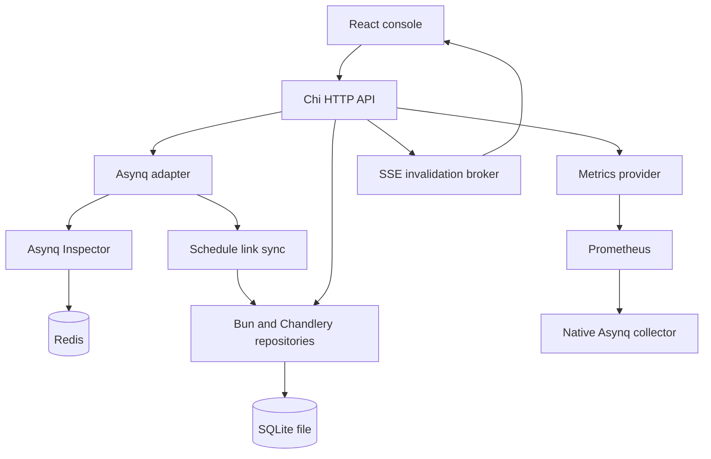

# Architecture and data provenance

The React/Vite client uses TanStack Router for typed file-based routing (one file per page in `apps/web/src/routes`; the Vite plugin generates and code-splits `src/routeTree.gen.ts`, which is committed so type checks work before a build), TanStack Query for server state and the generated Hey API SDK. Chi serves a versioned API and the compiled single-page app. Public contracts are application-owned DTOs; Asynq and Bun types never cross the HTTP boundary. `cmd/openapi` generates the canonical OpenAPI document from the explicit endpoint registry and DTOs. The TypeScript client is generated and committed, and CI regenerates it to check for drift.

## What the data means

Asynq v0.26.0 provides current queue counts, queue latency, processed and failed attempts (today and in total), task state, the last failure, next run and completion times a task retains, payloads, results and headers, retry settings, groups, server configuration with active workers, and live periodic schedule entries. Processed includes failures, so success is processed minus failed. Retained completed tasks are not the same as processed attempts. Queue priorities belong to each server's configuration, not to the queue.

Prometheus range queries provide historical queue depth, processing and failure rates, and latency. Spool uses Asynq's native Prometheus collector and never builds history from snapshots. Spool's own request metrics use the `spool_` prefix. Asynq has no native enqueue counter or full attempt history, and Spool does not pretend otherwise.

Asynq does not keep complete attempt histories, creation or enqueue times, uniqueness options, or public server heartbeat times. The UI shows only timestamps Asynq actually retains, plus orphaned active tasks. The servers Inspector returns are the ones currently registered; a history of stopped servers needs separate instrumentation, and the UI never guesses that a server is dead.

### Reading tasks without scanning Redis

Task lists use Asynq's paged list APIs. A cursor encodes the queue, state and page together with a fingerprint of the filters. Each request reads at most one page of up to 100 tasks (the UI asks for 50). Type, attempt and failure-time filters apply to that page, so a page can come back empty with a next cursor. A task ID plus queue uses a direct lookup. Aggregating tasks are listed only for a named group. Totals are per-state counts before page filters. Redis changes during pagination can shift records, as with the upstream API.

### Top errors

`GET /api/v1/failures/groups` samples the newest retained failures (500 by default, 50–1000) and groups them by task type and a normalized error message. Normalization removes timestamps, UUIDs, addresses, long hex IDs, quoted values and numbers of four or more digits, and keeps only the first line, so short HTTP status codes still separate groups. The sample is split across each queue's retry and archived sets; sets smaller than their share pass the remainder to larger ones. Asynq lists archived tasks oldest first, so Spool reads the last pages to get the newest. The response reports how many tasks were sampled out of the total and returns at most 50 groups.

### Needs attention

The dashboard checks run in the browser (`apps/web/src/features/attention.tsx`) over data the UI already loads: queues, servers, periodic schedules and, when Prometheus is available, the archived count over the last hour. They flag queues no running server processes, paused queues with work waiting, a slow oldest task (warning at 60 seconds, critical at 5 minutes), today's failure rate (warning at 10%, critical at 50%, once a queue has 20 attempts), archive growth, servers with every worker slot busy and periodic schedules overdue by more than two minutes.

### Periodic schedule links

Asynq records the last 1,000 tasks each periodic entry enqueued, but only while its scheduler runs: a clean scheduler shutdown deletes that history, and each restart registers new entry IDs. Every 10 seconds, when a task request needs it, Spool reads the history of every entry it knows about and stores new task-to-entry links and each entry's cron spec in the database. A task's schedule comes from the history still in Redis first, then from stored links, so links survive restarts of both the scheduler and Spool. Links older than 30 days are pruned hourly. Without a database, links last only while the history exists and Spool keeps running. Tasks enqueued while Spool was not running can't be linked once their history is gone.

## Freshness

One SSE ticker per process invalidates cached snapshots every 15 seconds while clients are connected; it never polls Redis itself. Mutations publish an immediate invalidation. Pages poll on top of that where the data moves faster:

| View | What is polled | Interval |
| --- | --- | --- |
| Live activity | Servers and their active workers | 2 seconds |
| Live activity | Queues and the next scheduled tasks and retries | 5 seconds |
| Task page | The task, while its state can change on its own | 3 seconds |
| Task page | The worker running it | 2 seconds |
| Metrics in live mode | Prometheus ranges and current values | 15 seconds |
| Charts otherwise | Prometheus ranges | 60 seconds |

Worker information comes from Asynq server heartbeats, which update roughly every five seconds, so running times can lag by a few seconds. The live tail is built by comparing successive worker snapshots; tasks that start and finish between samples don't appear. Hidden browser tabs close the event stream and pause polling.

## Persistence and safety

A SQLite file (`DATABASE_PATH`) stores the audit log, saved views, periodic schedule entries, schedule links and Spool's own log lines. A wrapping log handler queues every record without blocking and a background writer saves them in batches; records logged before the database opens wait in the queue, and the queue drops records rather than slow a request when it is full. HTTP request lines use a separate logger, so they reach standard output but are not stored. An hourly job deletes lines older than `SPOOL_LOG_RETENTION` (3 days by default), and inserts cap the table at 100,000 lines in between. The Logs page searches with a small field:value syntax translated to SQL, counts lines per level for its histogram, and polls every two seconds for live tail. Logs are served only to the administrator account, because error details can name internal hosts; credentials in URLs are redacted before logging. Redis remains the source of truth for tasks. Spool uses the pure-Go modernc driver with WAL journaling, foreign keys, a five-second busy timeout and a single connection, so exactly one instance may use a database file. Migrations are embedded in the binary and applied at startup. Chandlery's `db.Repository[*Model]` handles audit and saved-view creates and reads; Bun handles migrations, upserts and conditional audit updates.

Every queue or task action writes a pending audit record before it runs, then marks it succeeded or failed. A record left pending after a crash means the outcome is unknown. SQLite and Redis can't share a transaction, so if the final update fails Spool reports the outcome as unknown rather than letting an operator repeat the action blindly.

Each deployment connects to one environment, configured on the server and included in the session. Connection secrets never reach the browser. Use separate deployments for staging and production.

Session cookies are signed, HTTP-only and SameSite strict. Admin and viewer accounts are configured on the server, and role checks protect every change. Listening on a non-loopback address requires sign-in to be configured. Remote browser access uses secure cookies behind TLS; localhost HTTP uses ordinary cookies. Changes require an explicit confirmation in the request body, a custom action header and a same-origin request. Read-only mode disables all changes. Payloads are size-limited, never logged, and shown as base64 when they aren't valid UTF-8. Bulk actions are limited to 50 tasks and report a result for each.

## Installation and runtime configuration

`scripts/install.sh` configures one self-hosted environment. It saves connection URLs, generated secrets, console access settings and the Compose file list in `.env.installation`. Compose supplies runtime environment variables to the Go server, which creates its Redis adapter, SQLite store and Prometheus provider at startup. React assets are built independently of these credentials. The installer is a terminal workflow; accounts and connection settings are configured before startup rather than through browser onboarding.

The installer uses `compose.production.redis.yaml`, which keeps the SQLite file in the `spool-data` volume at `/data/spool.db`, and adds `compose.production.prometheus.yaml` for bundled metrics. Its private Prometheus service scrapes the app's native Asynq collector at `app:8003/metrics`. The database and metrics store have separate persistent volumes; Prometheus retains 15 days of samples. `compose.production.host.yaml` publishes the console on host loopback for local access or a host-installed proxy.

The server can run without a database or Prometheus when configured manually: an unset `DATABASE_PATH` disables all changes and durable saved views/audit/schedule links, while absent Prometheus disables historical charts. The guided installer supplies both by default. A configured external service is never replaced by a bundled fallback when it is unavailable.

`/health` checks the process; `/ready` checks Redis and, when configured, that the SQLite database opens. Prometheus does not affect server readiness. After Compose reports healthy services, the installer separately checks a successful bundled scrape or an external Prometheus query. Samples accumulate from the first successful scrape; installation does not reconstruct earlier history.

Runtime configuration changes require a redeployment. Preserve the installation file, project name and volumes across upgrades. For procedures and troubleshooting, see the [deployment guide](deployment.md).

An optional `SPOOL_METRICS_TOKEN` authenticates `/metrics` scrapes independently of console accounts. Without it, scrapes are unauthenticated and must stay private at ingress.

The session returns safe public instance identity and support metadata. Authenticated `/api/v1/status` performs independent Redis, database and Prometheus checks with a five-second response deadline and fixed, credential-free messages. Prometheus health validates its API response, checks the deployment’s configured scrape job and verifies sample warm-up using successful `up` samples. This is diagnostic information; it does not change readiness, task storage or chart query scope.
