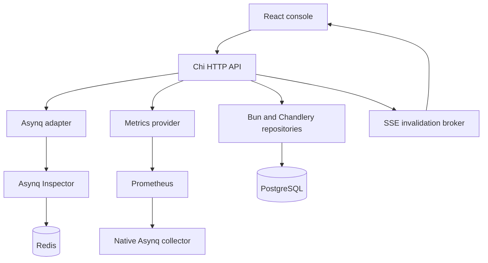

# Architecture and data provenance

The React/Vite client uses TanStack Router for typed routing, TanStack Query for server state and the generated Hey API SDK. Chi serves a versioned API and the compiled SPA. Public contracts are application-owned DTOs; Asynq and Bun types do not cross the HTTP boundary. `cmd/openapi` generates the canonical OpenAPI document from the explicit endpoint registry and DTOs. The client is generated and committed; CI regenerates and checks it.

## What the data means

Asynq v0.26.0 supplies current queue counts, queue latency, daily/cumulative processed and failed attempts, task state, retained last failure/schedule/completion times, payload/result/headers, retry settings, groups, server configuration and active workers, and live scheduler entries. Processed includes failures; success is processed minus failed. Retained completed tasks differ from processed attempts. Queue priorities belong to each server configuration, not to a global queue.

Prometheus range queries supply historical queue depth, failure/processed rates and latency. Spool uses Asynq's native Prometheus collector, not invented historical snapshots. The application exposes its own request metrics under a `spool_` prefix. No native enqueue counter or complete attempt history is claimed.

Asynq does not retain complete attempt histories, creation/enqueue timestamps, unique options or public server heartbeat timestamps. The interface shows only observed timestamps and orphaned active-task information. Servers returned by Inspector are the live registered set; missing/dead server history requires separate instrumentation. No frontend timeout heuristic labels servers dead.

Task collections use native Asynq page APIs. A cursor identifies queue/state/page with a filter fingerprint. Each request reads at most one bounded native page; type, retry and failure-time filters apply to that page and can yield empty pages with a next cursor. Exact ID plus queue uses direct lookup. Unscoped aggregating tasks are excluded; specify a group to inspect them. Totals are state counts before page filters. This avoids expensive Redis scans and browser-side bulk loading. Redis changes during pagination can shift records, as with the upstream API.

## Persistence and safety

PostgreSQL stores saved views and administrative audit records only. Chandlery `db.Repository[*Model]` handles create/read operations; Bun handles migrations and conditional audit updates. Redis remains task truth. An audit intent must commit before an operational action proceeds. The audit is then marked succeeded or failed; a pending record after a crash means outcome unknown. PostgreSQL and Redis cannot share a transaction. A finalization failure is reported as an unknown audit outcome so operators do not blindly repeat actions.

A single environment is configured server-side and included in session metadata. Connection secrets never reach the browser. Separate deployments can cover staging/production without adding speculative credential management. The provider and adapter boundaries allow more environments later.

Session cookies are signed, HTTP-only and SameSite strict. Admin and viewer accounts are configured server-side; role checks protect mutations. Non-loopback listening requires configured authentication. Production should enable secure cookies and terminate TLS. Mutations require an explicit confirmation body, a custom action header and same-origin checks. Read-only mode disables writes. Payloads are bounded, never logged, and non-UTF8 values are base64. Bulk actions are limited and report per-item results.

A single SSE ticker per application invalidates cached snapshots every 15 seconds only while clients are connected; it does not poll Redis itself. Mutations emit immediate invalidations. Historical queries refresh on a slower cadence. Reconnection refreshes current state. Browser visibility pauses periodic work.
